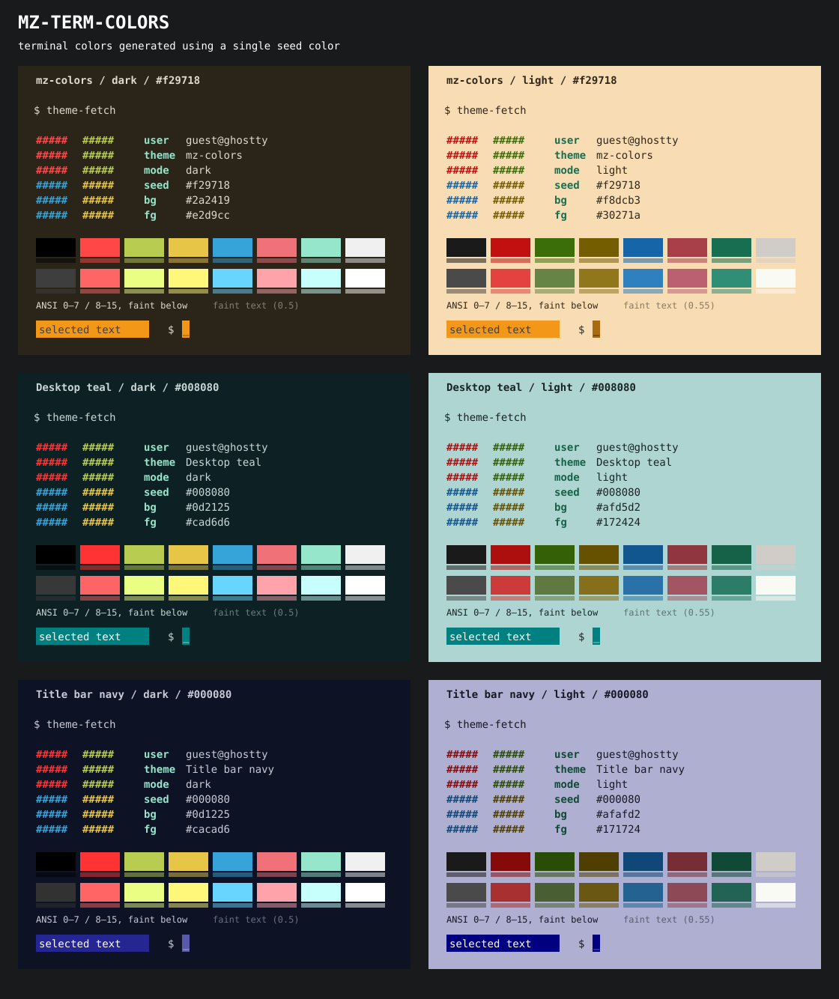

# mz-term-colors

Make dark and light terminal themes from one color. The generator is
`lib/theme.js`, plain JavaScript with no packages: the web generator, the CLI
`ghostty-colors`, the preview, and the Nix library use it. The first and only
output format is Ghostty.

Plays well with the preset themes of
[win-classic-theme](https://github.com/menduz/win-classic-theme).

```sh
# Print one theme.
nix run .#ghostty-colors -- '#008080' dark

# Install both themes.
nix run .#ghostty-colors -- '#008080' -o ~/.config/ghostty/themes -n teal
```

Add the output line to the Ghostty configuration:

```ini
theme = light:teal-light,dark:teal-dark
```

To use the published source, replace `.` with `github:menduz/mz-term-colors`.
The default package also runs `ghostty-colors`.

## Web generator

Open `web/index.html` in a browser; it needs no server and no build. Each of
the two columns, A and B (B is optional), shows a dark theme above a light
theme. A column is one of:

- **Color**: the themes of one color. Pick it from the colors of the
  [win-classic-theme](https://github.com/menduz/win-classic-theme) presets or
  pick any color. The options (the tints and the contrast ratios of
  `mkTheme`) let you compare one color with two sets of options.
- **Ghostty theme**: the text of two Ghostty theme files, pasted, opened from
  a file, or loaded from a preset of `web/ghostty-presets.js` (the themes of
  nix-config before mz-term-colors). *From* copies the generated files of the
  slot color, to change them by hand. A key that a file does not give takes
  the default of Ghostty.

Views:

- **Side by side**: the two columns, with the Ghostty files of each color.
- **Swipe**: A at the left of a divider and B at the right, as the image diff
  of GitHub. Drag on the image, or use the arrow keys on the divider.

The state is in the URL, so a comparison can be bookmarked.
`web/win-classic-colors.js` holds the presets. To read them again, run
`web/update-win-classic-colors.sh [path/to/presets.nix]`.

## Preview

Requires Node. Run from this directory:

```sh
./render.js
# Optional: select an output file.
./render.js -o /tmp/themes.svg
```

Edit `presets.json` to change the seed colors. The first preset uses the
default mz palette and signature orange (`#f29718`). Teal (`#008080`) and navy
(`#000080`) follow. After each theme change, run `./render.js`. Commit
`preview.svg` with the change.

The preview (`lib/preview.js`, also the columns of the web generator) shows
both variants, all 16 ANSI colors, selected text, and a cursor. Below each
ANSI color, a strip shows the color that Ghostty draws for faint text in that
color, with `faint-opacity` and `minimum-contrast`. The fetch
display uses fixed sample data. It does not read system data.



## Home Manager

```nix
{
  imports = [ inputs.mz-term-colors.homeManagerModules.ghostty ];
  programs.mz-term-colors = {
    themes.teal.color = "#008080";
    default = "teal";
  };
}
```

## Library

JavaScript (Node, or a `<script>` that defines `MzTermColors`):

```js
const gc = require('./lib/theme.js');
gc.toGhostty(gc.mkTheme({ color: '#008080', variant: 'light' }));
```

`fromGhostty(text)` reads a Ghostty theme file.
Use `mkThemes({ color: '#008080' })` for both variants. Use `mkTheme` to set
`background`, `foreground`, `tint`, `palette`, or `contrast`.

Nix: a build runs `theme.js` with Node, so a theme is a file in the store.

```nix
let gc = inputs.mz-term-colors.lib { inherit pkgs; };
in gc.ghosttyTheme { color = "#008080"; variant = "light"; }
```

`ghosttyThemes { color = "#008080"; }` gives `{ dark; light; }`. The
arguments are the arguments of `mkTheme`.

Minimum contrast ratios: text 7; cursor 3; selection 1.5 (on the background);
selection text 4.5; ANSI colors 4.5, except the bright colors red to cyan of
light themes: 3. On a light background, a color with 4.5 is dark; if the
bright colors also had 4.5, they would be almost equal to the normal colors.
Bright black: 1.4, dim as programs use it for hints and suggestions. Each
bright color is lighter than its normal color. Background palette slots (white
in light themes, black in dark themes) keep their source colors.

Each theme also sets two Ghostty options:

- `minimum-contrast = 1` (off, the Ghostty default). Ghostty draws text with
  less contrast in opaque white or black, also faint text: with 3, faint black
  in dark themes was white, and faint white in light themes was black, darker
  than the text. Text in a color of the role of the background (black in dark
  themes, white in light themes) is almost invisible, as in most themes.
- `faint-opacity`: 0.5 (the Ghostty default) or more, so faint text keeps a
  contrast of 3.

A tint that leaves the text without its contrast is reduced.

## Check

```sh
nix flake check
# Only the generator:
node tests.js
```

Checks cover 112 themes (14 colors, both variants, strong tints, no tint, and
the palette of the other variant): the contrast of each ANSI color, the color
that Ghostty draws after `minimum-contrast`, faint text, bright against normal
colors (lighter, and in light themes clearly different), and known values.
`nix flake check` also checks the Nix library and the Home Manager module.

## License

[Apache-2.0](LICENSE).
